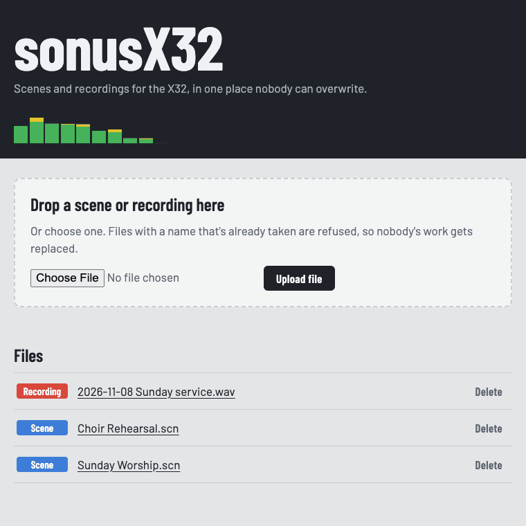
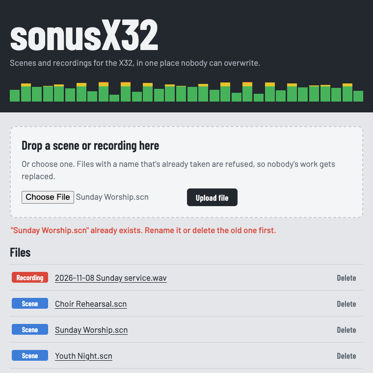
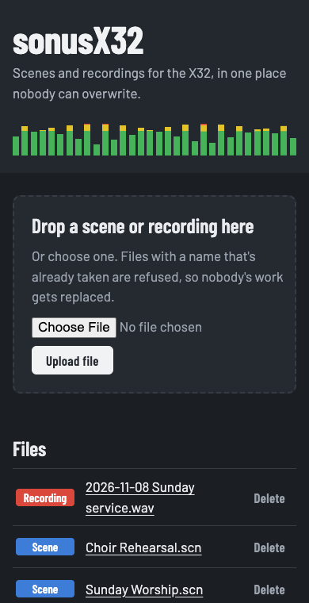

# 🎚️ sonusX32

**A shared home for your Behringer X32 scenes and recordings, where nobody can overwrite anybody else's work.**

<p align="center">
  
</p>

## 🎤 Why this exists

I run sound at my church. Our X32 is shared with another congregation, and so are its scenes and channel presets. That sharing kept going wrong: someone deleted a file that wasn't theirs, a Sunday scene got saved over, a recording went missing right before it was needed.

So I'm building **sonusX32**. *Sonus* is Latin for "sound", and the X32 is the mixer we're all trying not to step on each other's toes with.

## ✨ What it does today

| | |
|---|---|
| 📤 **Upload** | Drop a scene or recording on the page, or pick one. |
| 🛡️ **No overwrites** | If the name is taken, the upload is refused and the original stays safe. |
| 🎨 **Color-coded** | Scenes are blue, recordings are red, everything else is amber. |
| ⬇️ **Download** | Click a file name to grab it. |
| 🗑️ **Delete** | Asks first, and only ever touches files inside the recordings folder. |
| 🌙 **Anywhere** | Light and dark mode, and it works on a phone at the sound desk. |

<p align="center">
  
  &nbsp;
  
</p>

## 🚀 Run it

You need [Node.js](https://nodejs.org) 18 or newer.

```sh
npm install
npm start          # open http://localhost:5001
npm test           # 6 tests, about a second
```

Files are stored in `backend/recordings/`. To change the port or the folder:

```sh
PORT=8080 RECORDINGS_DIR=/Volumes/ChurchDrive/x32 npm start
```

Anyone on the same network can open `http://<this-computer's-IP>:5001`, so the booth laptop, the pastor's tablet and your phone all see the same files.

> ⚠️ There's no login yet. Keep it on your church network and don't expose it to the internet.

## 🗺️ Roadmap

What's planned, roughly in order:

- [x] Upload, list, download and delete, with no overwrites
- [ ] 🏷️ Tags and search ("Sunday Worship", "Choir Rehearsal", "Youth Night")
- [ ] 📁 Folders per congregation or ministry, so each group sees its own files first
- [ ] 🕓 Version history: keep old copies of a scene and restore one with a click
- [ ] 🔐 Simple logins, so every change shows who made it
- [ ] 💾 Automatic backups to an external drive or Google Drive
- [ ] 🎛️ Talk to the X32 directly over OSC to pull and push scenes
- [ ] 📅 Calendar-driven scene changes: load the right scene before each service
- [ ] 🔔 Alerts when storage runs low or a scene was never saved

## 🧰 How it's built

Deliberately small, so it's easy to keep running:

- `backend/index.js`: an [Express](https://expressjs.com) server, about 70 lines
- `backend/public/index.html`: the whole UI in one file, with no build step
- `backend/test.js`: tests using Node's built-in test runner

---

Made for the people in the booth. 🙏
